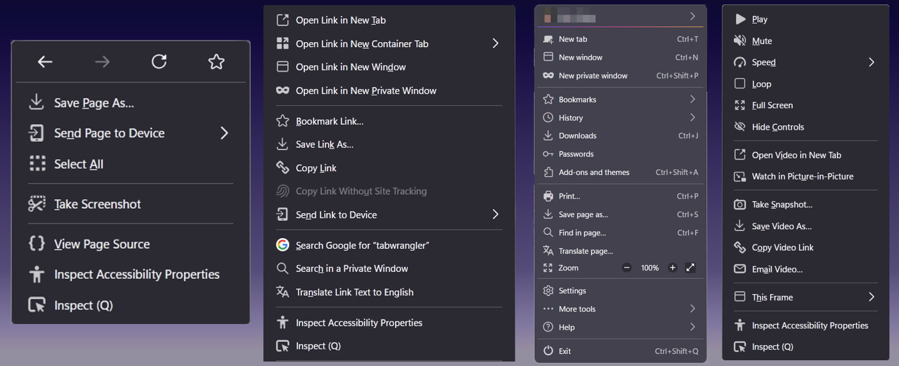

# Iconic Firefox 🦊 
[](https://ko-fi.com/emvaized)

This CSS snippet adds back icons for most context and popup menu entries in Firefox. Originally published as [Gist](https://gist.github.com/emvaized/a379d61ed8970e5711ca7278a39c1895).

## Features ##
- Adds icon to almost every entry in context menus and toolbar popups
- Uses only Firefox's built-in icons for optimal performance and authentic look
- Adds checkbox decoration to toggle-able menu items (such as "Loop" for video context menu)
- Icons are slightly dimmed relative to the text (75% opacity). Can be modified by `--uc-popup-menu-icon-color` variable
- Shows favicon of selected search engine for the "Search selected text in ..." context menu entry 

 

## Installation
Just add the code to your `userChrome.css` file, or import it as a separate file with `@import url(iconic_firefox.css );`. 
If you need help setting up the userChrome file, refer to the [guide](https://www.userchrome.org/). 

## Custom icons
This snippet uses only built-in icons of Firefox, which I carefully selected using [this guide](https://support.mozilla.org/gl/questions/961818). If you don't like some of them, you can easily change to the custom ones. For example, here's a more modern "link" icon you can use: 
```
background-image:url('data:image/svg+xml,<svg xmlns="http://www.w3.org/2000/svg" width="16" height="16" fill="context-fill"><path d="M2.7 9q.6.6 1.4.6T5.5 9l.3-.3-1-1-.3.3q-.4.5-.8 0L1.6 6a.6.6 0 0 1 0-1L5 1.7q.4-.4.8 0l2.1 2 .2.5-.2.4-.3.3 1 1 .3-.3Q10.2 4 9 2.7L7 .6a2 2 0 0 0-3 0L.7 4a2 2 0 0 0 0 2.8zm3-4.3-1 1 5.6 5.6 1-1zM10.5 16a2 2 0 0 1-1.4-.6L7 13.3a2 2 0 0 1 0-2.8l.3-.3 1 1-.3.3-.2.4q0 .3.2.4l2 2.1q.5.5 1 0l3.4-3.5q.5-.4 0-.8l-2-2.1a1 1 0 0 0-.9 0l-.3.3-1-1 .3-.3a2 2 0 0 1 2.8 0l2.1 2q1.2 1.5 0 3L12 15.3a2 2 0 0 1-1.4.6"/></svg>');
```